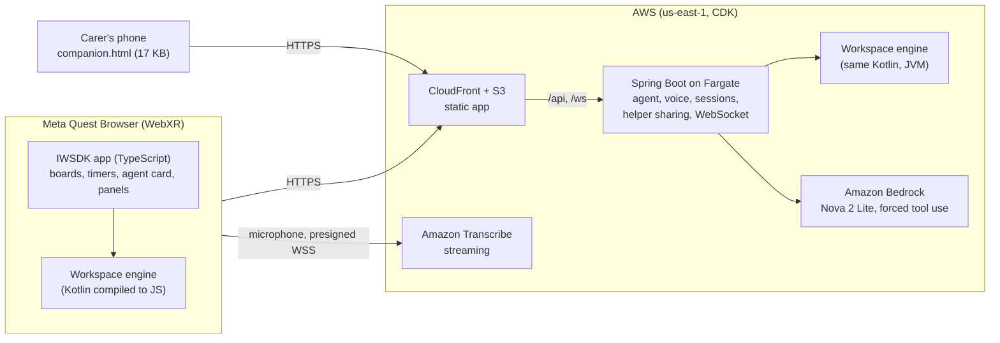

# SpatialDesk

**A workspace that adapts to your body, not the other way round.** On Meta Quest and Meta VR Glasses, delivered as
WebXR: no install, no account.

Spatial computing quietly assumes a body that turns its head, reaches out and pinches the air. About 1.3 billion people,
one in six, live with a significant disability (WHO, 2023), and many more have days when the neck, the hands or the eyes
are not up to it. In SpatialDesk you say what is hard, in your own words and language ("my neck hurts and I'm tired:
bring everything closer, on the right, and the text bigger"), and an AI agent reshapes the space around your body. Each
change comes with its reason and its own undo. A family member or carer can help from their phone without ever putting
the headset on.

**Live:** https://d2p3027seoreck.cloudfront.net  ·  **Video:** https://youtu.be/jtqAi3gl-os

SpatialDesk is a productivity tool, not a medical device.

---

## Try it in 60 seconds

| Where | What to do |
|---|---|
| **Meta Quest** | Open the link in Meta Quest Browser and press **Enter VR** (or **In my room** for passthrough). A three-question setup greets you: where you sit, pinch the orb, steady aim. Then say **"Plan my day"**. |
| **A desktop, no headset** | Open `/?emulate` (https://d2p3027seoreck.cloudfront.net/?emulate) and press **Enter VR**: Meta's IWER emulator stands in for the headset. |
| **The carer's view** | In the headset say **"Invite a helper"**. On a phone or a second tab open `/companion.html`, type the code, press **Allow** in the headset, and try the big **Help / Recalibrate** button. |

More: `?fast` (timers in seconds), `?handsfree` (eyes only), `?steady` (tremor), `?switch` (one switch),
`?lang=es-ES` (Spanish everywhere), `?emulate&glasses` (Meta VR Glasses' view).

---

## Innovation

**Adaptive accessibility: the space bends to the body.** A `Comfort` profile (reach, scale, side, allowed head turn,
tilt) lives in the workspace engine itself, and every panel is laid out from it. The agent changes it in plain words
("I can't turn my neck", "only my right hand", "I'm lying down"), one validated step per need, each with its ergonomic
reason. The body can also be measured directly: **"Fit to my reach"** turns one pinch into distance, height and side, and
**"I'm on the sofa"** lets the room fit accept a sofa seat or a bed as the surface.

**An asymmetric interface: help without a headset.** The person in VR can invite someone outside it. On any phone, the
carer types a short code; nothing is shown until the owner presses **Allow** in the headset. They then follow the Today
board live and have one very large button, **Help / Recalibrate**, that opens the guided calibration (and its orb) in the
headset, where the owner can skip any step. Consent first and the least that is enough: only card titles travel, the
carer can look and call but never configure, the sharing lasts at most 15 minutes, and **Stop** revokes it at once.

**An agent that acts on space, not in a chat.** Amazon Nova 2 Lite answers with a short plan of real operations (create
a board, move a card, start a timer, adapt the comfort zone), each with a *why*. Every plan is validated by the same
engine the headset runs before you see it, nothing changes until **Apply**, and the **AI log** undoes any step, even
after later changes.

**Spatial AI: it knows what "this" is.** Rest your eyes on a card for a second and say *"move this to Done"* or *"help me
start this"*. A ray from the centre of the view (the eyes, where the headset tracks them), tested five times a second,
remembers the card, column, board or timer you looked at; words that point send it to Nova as an id, which the server
marks in its own copy of the workspace. No text from the headset ever reaches the model's rules, and a request that
names its own task sends nothing.

**Every input, for every body.** Hands, controllers, look-and-pinch (Meta VR Glasses' input), the eyes alone (hold a
gaze), voice in your language, one switch (every control reachable with a single button), and **steady aim** for hands
that shake (the control aimed at for most of the last half second is the one pressed: 100 % correct presses at a 5 cm
synthetic tremor, against 59 % without it).

## User Experience

**Zero friction, from the first second.** No install, no account, no sign-in: each visitor gets an anonymous session and
the workspace lives on the device. The page opens on a dark splash, never a white flash; the start card says what this is
and offers **Enter VR** only where there is VR. In the headset, a newcomer is greeted by a guided calibration of three big
questions: where you sit, **pinch the orb** (your hand's own reach becomes your comfort zone), and whether you need pointer
stabilization. Someone coming back gets one quiet line above the board: *"Welcome back. Say 'Plan my day', or pinch it on
your panel."* It leaves as soon as they act.

**Calibration by voice or by hand.** "Recalibrate", "fit to my reach", "I'm on the sofa", "invite a helper": every
adjustment is one sentence away, in English or Spanish, and also a button.

**Push it with a finger.** The work board sits at arm's length, so a fingertip simply presses what it touches: from 5
cm the control lights and a ring on its surface shows where the finger will land, closing as it nears, and the control
gives way like a real key: a few millimetres back into its panel as the finger comes, then with the finger, springing
back as it leaves. Touching presses at once, however slowly. That matters for a careful hand or one with a tremor, which IWSDK's own poke would drop (it
counts a press only if the finger leaves within 800 ms). A finger that arrives from behind or slides along a panel
presses nothing.

**Sound from where things happen.** Every cue is an HRTF source at its own place: a faint tick from each new control a
pointer comes onto (never two within 120 ms, however fast it sweeps), the click from the button pushed, the alarm from
the timer, and a panel gliding to its place breathes a soft whoosh that follows it as it moves.
Every cue stays put in the room as the head turns.

**Nothing jumps, everything answers.** When the space adapts, panels glide to their new place in under a second (a
critically damped spring, no overshoot) instead of teleporting, and they take no pointer while moving, so a hand they
pass through presses nothing. The space confirms it has settled with an amber glow round the work board and a faint
controller pulse. Cards rise a little under the pointer, and hover follows Meta's eye-tracking guidance: the control
itself brightens, and a card under a ray, or rested on by the gaze for a second (the head's direction on Quest 3, the eyes where a headset tracks them; it is then "this" for the agent), wears
a soft rim of light outside its edge that breathes slowly, leaving the centre the eyes aim at alone. While Nova thinks,
an orb breathes beside its words instead of a counter. In passthrough every board casts a soft shadow on the real wall behind it. Reduced
motion turns the movement off.

**Gentle on attention.** A small companion works beside your board (body doubling), the world beyond arm's reach dims
during a focus block, *Start small* turns a task into a five-minute first step, and the day has a start (a plan from
yesterday's open work) and an end (a wrap-up that sets up tomorrow).

## Technical Execution

**Performance, measured as a gate.** The build fails if the app is heavier than Meta's own IWSDK starter scene, measured
in the IWER Quest 3 emulator on the production build with the CPU throttled 3x: whole frame p95 ≤ 29.4 ms, our own
systems ≤ 3 ms p95, ≤ 80 draw calls, ≤ 4 KB allocated per frame, bundle ≤ 2.5 MB gzipped. Recent runs on a cool laptop:
**25.8 ms p95** for the whole frame, **1.4 to 1.7 ms p95** for our systems, 78 draw calls, about 70 bytes per frame,
2.31 MB. The carer's page is 17 KB and loads none of the XR app.

**Meta platform capabilities, used for what they are for.**
- **Passthrough** (`immersive-ar`): *In my room* puts the workspace in your real room.
- **Scene understanding through WebXR plane detection:** *Fit room* stands the work board on your real desk and hangs
  the other boards on your walls, clear of doors and windows. Tested in all 13 rooms of Meta's Synthetic Environment
  Module, none tuned for.
- **Persistent spatial anchors:** the fitted layout is kept relative to an anchor and comes back to the same place next
  time.
- **Hand tracking** and **controllers**, with pinch, ray and direct touch (the index fingertip, or a controller's tip);
  **eye tracking** for hands-free use, look-and-pinch and telling the agent what you look at; **haptics** when the space
  settles; **spatial audio** (HRTF) for every cue.
- **Meta VR Glasses:** the app measures the view the device actually renders and fits the layout into its comfortable
  part (Meta's 58 x 54 degree perceived view).

**Graceful degradation.** The workspace is local-first (IndexedDB) and never waits for the network. If the AI or the
voice takes more than 7 seconds, or the network drops, "thinking" ends with one calm line (*Network issue. Switched to
manual mode.*) and every card keeps working by hand. If Nova is slow, the server's built-in planner answers within the
headset's patience and says so. The carer's view shows *Reconnecting* and keeps the last board until the network returns.

**Engineering.** One Kotlin Multiplatform engine runs in both places: compiled to JS in the headset, on the JVM on the
server, where it validates every AI plan before the headset sees it. Spring Boot on Fargate calls Amazon Nova 2 Lite
through Bedrock with a single forced tool; Amazon Transcribe streams speech over a URL the server presigns (no credentials
in the browser, no audio through the server); quotas bound the bill; AWS CDK deploys it all. Every quality claim below is
an automated check that fails the build.

## The future of VR

Headsets have earned their place as game consoles. The next step is a device you reach for because it makes your day
possible: one that **adapts to your body**, works on the day your neck or hands or eyes are not up to it, and **brings in
the people who help you** without asking them to wear anything. SpatialDesk shows the pattern: a comfort profile the whole
space obeys, an agent that changes the world rather than chatting about it, every control reachable by any input, and a
carer who can lend a hand from a phone. On all-day glasses, that becomes a tool for **human autonomy**: the same person,
on a good day and a bad one, working, planning and finishing what they started.

---

## How it was verified without a headset

Every claim is an automated check that fails the build, run in Meta's IWER Quest 3 emulator on the production build:

| Claim | Check |
|---|---|
| Runs smoothly on a Quest | Worst-case workspace, CPU throttled 3x, hands-free on (our heaviest mode). App systems ≤ 3 ms p95; the whole frame no heavier than Meta's IWSDK starter scene under the same conditions (p95 29.4 ms); ≤ 80 draw calls; bundle ≤ 2.5 MB gzipped. |
| The first seconds | A dark splash covers the load and is gone once the world draws; the start card offers Enter VR only where VR exists and its Enter VR enters it; a newcomer's setup opens with a welcome, someone back gets a banner above the board that leaves as soon as they act. |
| Physical presence | In passthrough each board and timer casts a soft shadow that follows it (one instanced mesh, one draw call); in VR none is drawn. A card under the pointer brightens and rises 2.5 to 5 % and settles back when the pointer leaves; it wears a rim of its own size that breathes (dimmer and brighter, never out, never a jump) and leaves with the ray; the gaze (the head on Quest 3) lights it after a second's rest, not before; reduced motion holds it still. |
| Usable with hands | Every interactive target is ≥ 6 x 6 cm and within arm's reach of a seated user, and is hit by ≥ 95 % of 400 rays jittered like hand tracking (±1 cm origin, 3° cone). |
| Comfortable seated | Focus board at 0.55-0.65 m, no overlapping near panels, parked boards ≥ 1.3 m away; looking at a side panel to tap it never moves the desk. |
| Adapts to the body | Engine tests for nine bodies and three postures; in the emulator a spoken request gathers everything on the right with the console by the right hand, and one undo takes it back. |
| Panels glide | A comfort change moves a board 27 cm with no frame carrying more than ~6 % of the way and arrives within 1 mm in under a second; the undo glides back; a sliding panel takes no pointer; a move under 4 cm, a flat screen or reduced motion places at once. |
| A carer outside the headset | Two pages of one browser, and the same story against the real server: invite, code, nothing shown before Allow, only card titles travel, the board follows the headset, Help / Recalibrate opens the setup and the carer learns how it ended, a lost network is shown and recovered, titles are text and never markup. |
| Nova's second or two | While the agent thinks, an orb breathes beside "Thinking..." on its card (the core swells and settles, a ring of light rises and fades), in conversation too, and is gone when the answer comes. |
| Fails gracefully | An AI or a voice slower than 7 s, a gateway error or no network ends "thinking" and "listening" with one calm line, and a card is still moved by hand afterwards; a spent quota is explained. |
| The agent is useful and safe | Planner tests on the server (normaliser, guardrails, retry, fallback). End-to-end against production: a plan applied in under 4 s (typically 2-3 s). |
| Guided calibration | Where you sit, the pinch's own reach, height and side, steady aim; applied in one undo; Skip at any step; "recalibrate" brings it back. |
| Steady aim | Synthetic tremor on the real button grid (3,000 presses per strength): at 3.5 cm, 81.2 % correct without tremor mode and 100 % with it; at 5 cm, 59.0 % and 100 %. A model of selection, not a clinical measure. |
| One switch | The space bar or any pinch chooses the control lit; the agent's card takes over the scan while open; a tap elsewhere presses nothing. |
| Knows what "this" is | A second's look at a card makes it "this" (tested about five times a second, not every frame); "move this to done" sends the card's id and nothing else about it, "plan my day: ..." sends nothing, "help me start this" starts that card, a removed card is no longer "this", the command panel never becomes it. On the server, the item is marked in the workspace and the rule for "this" is added only when the id exists. |
| Direct touch | A controller's tip and a tracked index fingertip: from 5 cm the control is lit and a ring closes in; touching presses once, at once; a press held 1.5 s is still one press; drawing back 1 cm does not re-arm, 2 cm does; a finger from behind presses nothing. The button really moves back in proportion to the finger's nearness from 5 cm (within a quarter of a millimetre), goes with the finger once touched (up to 12 mm, still one press) and is back in its place within 0.2 s. |
| Sound from its place | A sweep across six cards in six frames ticks no more than once every 120 ms, and a pointer onto a new card ticks from that card (within 2 cm); the click is sounded from the pushed button (within 2 mm); a glide's whoosh follows its board as it moves and, after a quarter turn of the head, is heard from the side. |
| Hands-free | With the head or eyes as the only input: a held gaze presses, a glance does not, a press never repeats, cards move by gaze alone. |
| Voice | The command grammar, the AWS event-stream framing (CRC-32 check value), the capture path against a stand-in Transcribe, and the real Transcribe hearing a spoken "plan my day". |
| Ready for Meta VR Glasses | In the glasses profile the measured view is 58 x 54 degrees and the board, its timer and the agent's card lie inside it; look-and-pinch picks a card up and drops it. |
| Holds up in rooms never tested | *Fit room* in all 13 rooms of Meta's Synthetic Environment Module: the board stands 3 cm above the surface at 0.62 m and never through a wall; boards hang clear of doors and windows. |

`npm run ci` runs the typecheck, every Playwright gate and the size check; `server/gradlew test` runs the engine, layout,
server and infrastructure tests.

## How it is built



- **Client:** Meta Immersive Web SDK 1.0 (TypeScript, three.js, UIKit panels); the IWER emulator loads only with
  `?emulate`. State in IndexedDB.
- **The agent:** Bedrock Converse with one forced tool, `submit_plan`, whose steps are the engine's own operations. The
  server normalises the model's usual slips, checks guardrails computed from the workspace, validates the plan on the
  engine, retries once with the exact error, and falls back to a built-in planner that says so. 20 plans per session per
  hour, 300 per day.
- **Voice:** an AudioWorklet turns the microphone into 16 kHz PCM framed as AWS event-stream messages, sent to a
  Transcribe URL the server presigns with hand-written SigV4.
- **The carer's sharing:** a short-lived room on the server (two-minute code, 15-minute room, owner approval, at most
  twelve card titles, help calls with a cooldown and a ceiling); the headset and the phone poll it every two seconds.
- **Motion and presence:** a critically damped spring for panel moves, one instanced mesh for every shadow, one shader
  ring for the gaze, a single mesh for the amber frame and its glow; nothing allocated per frame.
- **Infrastructure:** AWS CDK in Kotlin: S3 + CloudFront; an ALB reachable only from CloudFront; Fargate. The task role
  may invoke one Nova model and stream to Transcribe, nothing else.

## Run it locally

You need Node 20 or later, JDK 17 and Microsoft Edge (the tests use the installed Edge).

```bash
npm install
npm run dev:runtime            # the app at http://localhost:8081 (add ?emulate for the emulator)
```

The agent needs the server. To run it with the built-in planner and no AWS:

```bash
cd server && ./gradlew :app:bootJar && cd ..
SPATIALDESK_AGENT_MODE=built-in npm run server:run
```

With Bedrock, use your own AWS credentials and the default mode.

```bash
npm run ci                     # all gates (builds the production bundle first)
node scripts/deploy.mjs        # your AWS account: CDK deploy, then the end-to-end tests against it
```

## Repository

| Path | What |
|---|---|
| `src/` | The WebXR app: `workspace/` (boards, timers, undo journal), `agent/`, `voice/`, `room/` (passthrough fit and persistent anchor), `assist/` (the carer's sharing, headset side), `companion/` (the carer's page), `onboarding/` (guided calibration, coach, welcome), `studio/`, `ui/` (glide, shadows, hover, gaze, field of view, sounds) |
| `public/ui/*.uikitml` | Panel layouts |
| `server/shared` | The Kotlin Multiplatform workspace engine, layout and protocol |
| `server/app` | Spring Boot: sessions, WebSocket, the planning agent, voice streams, the helper sharing |
| `server/infra` | AWS CDK stack |
| `tests/` | Playwright gates in the IWER emulator |
| `docs/` | Submission texts, status report and the execution log |
