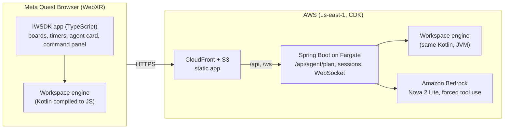

# SpatialDesk Command Center

A hands-first workspace for Meta Quest, delivered as WebXR. You describe your day; an AI agent turns it into boards
and focus timers around you, explains every step it takes, and lets you undo any one of them.

**Try it:** https://d2p3027seoreck.cloudfront.net

- **On a Quest:** open the link in Meta Quest Browser and tap *Enter workspace*. Hands or controllers both work.
- **On a desktop:** add `?emulate` (https://d2p3027seoreck.cloudfront.net/?emulate). Meta's IWER emulator stands in for the
  headset; click *Enter workspace*, then use the emulated controllers, or click the panels with the mouse.

- **For a short session:** add `?fast` (or `?emulate&fast`) and timers run in seconds instead of minutes, so you can
  see what the agent does when a focus block ends.

No install, no account. Each visitor gets an anonymous session, and the workspace is stored on the device.

## What it does

- **Describe your day, get a workspace.** "Finish the quarterly report, review two pull requests, call the dentist,
  gym at 18:00" becomes a *Today* board in front of you, the rest parked at the sides, and a 25-minute focus timer
  on the first task.
- **The agent acts on the space, not in a chat.** *Plan my day* and *Prioritise* answer with a short plan of real
  operations (create a board, move or edit a card, start a timer, arrange the space), each with its reason. Nothing
  changes until you tap *Apply*.
- **It notices things on its own.** When a focus block ends it suggests the next one (or a break, if the task is not
  done yet); when a task runs over its estimate it offers to replan; when a board gets crowded it offers to regroup.
  Suggestions wait for one tap; the agent never acts without you.
- **Every action is explained and undoable.** *AI log* lists what the agent did, step by step, with the reason for
  each and its own *Undo*, even after you have made changes since. If a later step depended on it, that one goes
  too, and the app says so.
- **Hands first.** Pick a card up with a tap or pinch, drop it on a column, and it snaps into place. Boards and timers
  can be grabbed and pinned anywhere; *Bring to me* gathers everything back around you.
- **Seated and comfortable.** The board you work on sits 62 cm away, slightly below the eyes; everything else waits at
  the sides. Tapping a side panel never swings the workspace toward it.
- **Accessible.** A three-step guided start (under a minute, skippable), high contrast mode (white text and outlines),
  sound cues panned toward the panel that made them, and plans read aloud. Settings are remembered.

## How it is built



- **Client:** Meta Immersive Web SDK 1.0 (TypeScript, three.js, UIKit panels), with the IWER emulator loaded only for
  `?emulate`. State lives in IndexedDB, and the app keeps working offline.
- **One engine, two runtimes:** the workspace rules (boards, cards, timers, layout, every operation) are a Kotlin
  Multiplatform module. The headset runs it compiled to JS; the server runs the same code on the JVM to validate
  every plan before the headset sees it.
- **The agent:** Spring Boot calls Amazon Nova 2 Lite through the Bedrock Converse API with a single forced tool,
  `submit_plan`, whose steps are the engine's own operations, each with a `why`. The server then:
  1. normalises the model's usual slips;
  2. checks guardrails computed from the workspace: a task that has used 25 of its 120 estimated minutes is not
     done, and a replan does not start timers;
  3. validates the plan on the engine;
  4. retries once with the exact error.

  If that still fails, a built-in planner answers and says so. Quotas cap each session at 20 plans per hour and the
  whole server at 300 per day.
- **Infrastructure:** AWS CDK in Kotlin: S3 + CloudFront for the app; an ALB (reachable only from CloudFront) and
  Fargate for the server. The task role may invoke that one Nova model and nothing else.

## How it was verified without a headset

Every quality claim is an automated check that fails the build, run in Meta's IWER Quest 3 emulator on the
production build:

| Claim | Check |
|---|---|
| Runs smoothly on a Quest | Worst-case workspace, CPU throttled 3x. The app's own systems must stay ≤ 3 ms p95. The whole frame must be no heavier than Meta's own IWSDK starter scene measured under the same conditions (p95 29.4 ms), with ≤ 80 draw calls and a bundle ≤ 2.5 MB gzipped. Last quiet-machine run: app systems 0.4 ms, frame 24.5 ms, 74 draw calls, 2.25 MB. |
| Usable with hands | Every interactive target is ≥ 6 x 6 cm and within arm's reach of a seated user. Each target is hit by ≥ 95 % of 400 rays jittered like hand tracking (±1 cm origin, 3° cone). |
| Comfortable seated | Layout invariants for seated, standing and turned users: focus board at 0.55-0.65 m, no overlapping near panels, parked boards ≥ 1.3 m away. Looking at a side panel to tap it never moves the desk. |
| The agent is useful and safe | Planner tests on the server (normaliser, guardrails, retry, fallback). End-to-end against production: a plan applied in under 4 s (typically 1.5-2 s). |
| First five minutes | The guided start, done with real pointer events, finishes well under a minute (measured: 2 s of input). |
| Fails gracefully | A spent quota and an unreachable server are explained on the agent card; the workspace is untouched. |

`npm run ci` runs the typecheck, every Playwright gate and the size check; `server/gradlew test` runs the engine,
layout, server and infrastructure tests.

## Run it locally

You need Node 20 or later, JDK 17 and Microsoft Edge (the tests use the installed Edge).

```bash
npm install
npm run dev:runtime            # the app at http://localhost:8081 (add ?emulate for the emulator)
```

The agent needs the server. To run it with the built-in planner and no AWS:

```bash
cd server && ./gradlew :app:bootJar && cd ..
SPATIALDESK_AGENT_MODE=built-in npm run server:run
```

With Bedrock, use your own AWS credentials and the default mode.

```bash
npm run ci                     # all gates (builds the production bundle first)
node scripts/deploy.mjs        # your AWS account: CDK deploy, then the end-to-end test against it
node scripts/make-video.mjs    # the demo video: Piper voice-over, IWER recording, captions (needs Docker, ffmpeg)
```

## Repository

| Path | What |
|---|---|
| `src/` | The WebXR app: `workspace/` (boards, timers, store with undo journal), `agent/` (agent card, watcher, client), `onboarding/`, `ui/` (settings, sounds, panel hit testing) |
| `public/ui/*.uikitml` | Panel layouts (boards, timers, command panel, agent card, coach) |
| `server/shared` | The Kotlin Multiplatform workspace engine, layout and protocol |
| `server/app` | Spring Boot: sessions, WebSocket, the planning agent |
| `server/infra` | AWS CDK stack |
| `tests/` | Playwright gates in the IWER emulator |
| `docs/` | Submission texts, demo script and narration |
