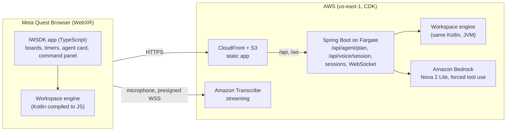

# SpatialDesk

A focus companion for minds that wander, on Meta Quest and Meta VR Glasses, delivered as WebXR. You tell it your
day; an AI agent turns it into boards and focus blocks around you, a small companion works beside you through each
block, and the world beyond arm's reach fades while you focus. The agent explains every step it takes, and you can
undo any one of them.

**Why.** Starting is the hard part, and staying with it comes next. Many people whose attention wanders, many with
ADHD among them, find both easier with someone working beside them: *body doubling*. In a VR study, adults with ADHD
finished tasks faster and reported better sustained attention with a human or an AI body double than alone; the same
work notes that a person's presence can also feel uncomfortable ([*You Are Not Alone: Designing Body Doubling for
ADHD in Virtual Reality*](https://arxiv.org/abs/2509.12153), 2025). So the companion here is a small light with no
face and no words, and it goes wherever the headset goes: Meta pitches its VR Glasses as a workspace for a flight.
SpatialDesk is a productivity tool, not a treatment.

**Try it:** https://d2p3027seoreck.cloudfront.net

- **On a Quest:** open the link in Meta Quest Browser and tap *Enter VR*, or *In my room* to use it in passthrough. Hands or controllers both work.
- **On a desktop:** add `?emulate` (https://d2p3027seoreck.cloudfront.net/?emulate). Meta's IWER emulator stands in for the
  headset; click *Enter VR*, then use the emulated controllers, or click the panels with the mouse.

- **For a short session:** add `?fast` (or `?emulate&fast`) and timers run in seconds instead of minutes, so you can
  see what the agent does when a focus block ends.
- **Without hands:** add `?handsfree` to start in hands-free mode, and press *Talk* (by gaze) for voice.
- **As on Meta VR Glasses:** add `?emulate&glasses`: the glasses' narrower view, eye tracking and hands. Look at a
  card and pinch (hold the left mouse button in IWER's *Gaze + Hands* mode) to pick it up.

No install, no account. Each visitor gets an anonymous session, and the workspace is stored on the device.

## What it does

- **Describe your day, get a workspace.** "Finish the quarterly report, review two pull requests, call the dentist,
  gym at 18:00" becomes a *Today* board in front of you, the rest parked at the sides, and a 25-minute focus timer
  on the first task.
- **The agent acts on the space, not in a chat.** *Plan my day* and *Prioritise* answer with a short plan of real
  operations (create a board, move or edit a card, start a timer, arrange the space), each with its reason. Nothing
  changes until you tap *Apply*.
- **It notices things on its own.** When a focus block ends it suggests the next one (or a break, if the task is not
  done yet); when a task runs over its estimate it offers to replan; when a board gets crowded it offers to regroup.
  Suggestions wait for one tap; the agent never acts without you.
- **A companion beside your board.** A small light floats by the board you work on, wherever the board goes. Through
  a focus block it works with you, its gaze on the board and the time left round its middle; it shimmers while the
  agent thinks, turns to you when the agent has something to show, rests calm in a break and hops when a block is
  done. No face, no words, nothing to manage: the agent's presence in the space.
- **A focus bubble.** During a focus block everything beyond arm's reach fades and the board stays clear: in your room
  the real room recedes and your desk stays; in VR night falls over the hills. A break brings the world back.
  "Dimming off" turns it off.
- **Every action is explained and undoable.** *AI log* lists what the agent did, step by step, with the reason for
  each and its own *Undo*, even after you have made changes since. If a later step depended on it, that one goes
  too, and the app says so.
- **Hands first.** Pick a card up with a tap or pinch, drop it on a column, and it snaps into place. Boards and timers
  can be grabbed and pinned anywhere; *Bring to me* gathers everything back around you.
- **Seated and comfortable.** The board you work on sits 62 cm away, slightly below the eyes; everything else waits at
  the sides. Tapping a side panel never swings the workspace toward it.
- **Talk to it.** *Talk* takes a spoken command ("focus", "undo", "yes", "high contrast on") or a request in your own
  words, which the agent answers with a plan to review. Audio streams straight to Amazon Transcribe.
- **Hands-free.** Look at any control and hold your gaze until the ring fills (`?handsfree` starts in this mode).
  Where the headset tracks the eyes it follows them, so the head can stay still: navigation with the eyes alone.
  With *Talk*, the whole workspace works without hands or controllers.
- **Ready for Meta VR Glasses.** The app measures the view the headset actually renders (each eye's projection) and
  fits the layout into its comfortable part: on a Quest as designed; on the glasses the panels shrink to 0.85 so the
  board, its timer and the agent's card all stay inside Meta's 58 x 54 degree perceived view. Look and pinch (the
  glasses' primary input) works on every control, and hover follows Meta's eye-tracking guidance: a subtle colour
  change on the control itself, never an outline, fading on in 300 ms and off in 400 ms.
- **In my room.** Passthrough on Quest 3/3S: *Fit room* stands the work board on your real desk, timers and the focus
  plant beside it, and hangs the other boards on your real walls, clear of doors and windows (plane detection); a
  persistent anchor puts everything back there next time. A focus block there leaves the boards where they stand. Tested in all 13 rooms of Meta's Synthetic Environment
  Module, none of them tuned for.
- **A studio, a desk and a plant.** In VR you work at dusk, at a walnut desk the board stands on, over low hills. A
  focus plant on the desk grows a leaf with every focus block and blossoms every sixth; it never wilts.
- **Days with a start and an end.** In the morning the agent offers to plan today from what is still open; in the
  evening, after a day of focus, to wrap it up (*Wrap up*, or "call it a day"): it names what got done, clears it away
  and puts tomorrow's first task on top, and tomorrow's plan starts from its words. Today's focus blocks, a streak
  and the last seven days are on the command panel.
- **Sound.** Every cue is one soft instrument on one scale, heard from where it happens: a tap from the control, the
  alarm from the timer, a new leaf from the plant. During a focus block a quiet ambience of soft air breathes in.
- **Accessible.** A three-step guided start (under a minute, skippable), high contrast mode (white text and outlines),
  sound cues placed where they happen, plans read aloud, and the focus bubble for fewer things in view. Every control
  works by hand, by look and pinch, by voice and by the eyes alone. Settings are remembered.

## How it is built



- **Client:** Meta Immersive Web SDK 1.0 (TypeScript, three.js, UIKit panels), with the IWER emulator loaded only for
  `?emulate`. State lives in IndexedDB, and the app keeps working offline.
- **One engine, two runtimes:** the workspace rules (boards, cards, timers, layout, every operation) are a Kotlin
  Multiplatform module. The headset runs it compiled to JS; the server runs the same code on the JVM to validate
  every plan before the headset sees it.
- **The agent:** Spring Boot calls Amazon Nova 2 Lite through the Bedrock Converse API with a single forced tool,
  `submit_plan`, whose steps are the engine's own operations, each with a `why`. The server then:
  1. normalises the model's usual slips;
  2. checks guardrails computed from the workspace: a task that has used 25 of its 120 estimated minutes is not
     done, and a replan does not start timers;
  3. validates the plan on the engine;
  4. retries once with the exact error.

  If that still fails, a built-in planner answers and says so. Quotas cap each session at 20 plans per hour and the
  whole server at 300 per day.
- **Voice:** an AudioWorklet turns the microphone into 16 kHz PCM, framed as AWS event stream messages and sent over a
  WebSocket to Amazon Transcribe that the server presigns (hand-written SigV4, tested against AWS's documented
  example). No credentials in the browser, no audio through the server; 60 listens per session per hour, 600 a day.
- **Hands-free and gaze:** a system tests the gaze ray (the eyes where tracked, else the head) against each panel's
  plane, then the control rectangles of the panel looked at, and fills a one-draw-call shader ring; no allocation per
  frame. Look and pinch is IWSDK's gaze pointer driving the same panels as hands.
- **Field of view:** `src/ui/view-fit.ts` reads each eye's projection matrix when a session starts; the shared engine
  (`Layout.fit`) finds the largest panel scale at which the essential panels fit and re-places what sits in its slot
  (a board the user moved stays put).
- **The studio:** three procedural assets (desk, plant, horizon), one unlit draw call each with the light baked into
  their vertex colours; the plant rewrites its preallocated geometry in place while a leaf unfurls.
- **The companion and the bubble:** the companion is one shader-drawn orb (one draw call) whose uniforms ease toward
  its mood each frame, read from the timers and the agent's state. In passthrough the bubble is one back-facing sphere
  round the head, drawn after the scene and before the panels, darkening what lies beyond 1.25 m, with a hole where
  the cone toward the board is clear; in VR the sky's intensity and the hills' colour dim instead, at no fill cost.
- **Sound:** Web Audio synthesis (no files): one mallet voice on a pentatonic scale, HRTF panners placed relative to
  the head when a cue plays, and a looped brown-noise ambience during focus blocks.
- **Infrastructure:** AWS CDK in Kotlin: S3 + CloudFront for the app; an ALB (reachable only from CloudFront) and
  Fargate for the server. The task role may invoke that one Nova model and stream to Transcribe, nothing else.

## How it was verified without a headset

Every quality claim is an automated check that fails the build, run in Meta's IWER Quest 3 emulator on the
production build:

| Claim | Check |
|---|---|
| Runs smoothly on a Quest | Worst-case workspace, CPU throttled 3x. The app's own systems must stay ≤ 3 ms p95. The whole frame must be no heavier than Meta's own IWSDK starter scene measured under the same conditions (p95 29.4 ms), with ≤ 80 draw calls and a bundle ≤ 2.5 MB gzipped. Measured with hands-free on (the gaze ray tested every few frames, our heaviest mode). Last runs, with the companion and a focus block's bubble on: app systems 1.9 ms p95, frame 26.7-28.5 ms p95, 78 draw calls, 2.27 MB. |
| Usable with hands | Every interactive target is ≥ 6 x 6 cm and within arm's reach of a seated user. Each target is hit by ≥ 95 % of 400 rays jittered like hand tracking (±1 cm origin, 3° cone). |
| Comfortable seated | Layout invariants for seated, standing and turned users: focus board at 0.55-0.65 m, no overlapping near panels, parked boards ≥ 1.3 m away. Looking at a side panel to tap it never moves the desk. |
| The agent is useful and safe | Planner tests on the server (normaliser, guardrails, retry, fallback). End-to-end against production: a plan applied in under 4 s (typically 1.5-2 s). |
| First five minutes | The guided start, done with real pointer events, finishes well under a minute (measured: 2 s of input). |
| Fails gracefully | A spent quota and an unreachable server are explained on the agent card; the workspace is untouched. |
| Hands-free works and does not misfire | With the head as the only input: a held gaze presses, a glance does not, a press never repeats, cards move by gaze alone. |
| Voice works | The command grammar, the event stream framing (CRC-32 check value), the browser capture path against a stand-in Transcribe, and the real Transcribe hearing a Piper-spoken "plan my day" (`tests/e2e-voice.spec.ts`). |
| A reason to come back | Streaks that survive the morning, the seven-day strip, and the agent's start-of-day plan from yesterday's open work; the evening wrap-up (server guardrails: no timers, no new boards) and the next morning starting from it; a focus block grows the plant a leaf, a break does not. |
| Ready for Meta VR Glasses | In IWER's glasses profile: the measured view is 58 x 54 degrees, and every corner of the focus board, its timer and the agent's card lies inside it; a look and a pinch of either hand picks a card up and drops it; hands-free presses a control with the eyes while the head stays still. Engine tests: the Quest layout is exactly as designed, and a view too narrow for anything still gets a readable one. |
| Holds up in rooms never tested | *Fit room* in all 13 rooms of Meta's Synthetic Environment Module (8 procedural, 5 scanned), the user seated at whatever surface each has: the board stands 3 cm above it at 0.62 m and never through a wall, timers stand on it or hover above the board on a small one, the plant stays inside its outline, boards hang clear of doors and windows. 11 rooms have a desk-height surface; in the other 2 nothing moves onto one. |
| The companion and the bubble | The companion stays beside the board wherever it goes, and its mood follows the work: idle, focus (the time left shrinking), thinking while the agent plans, speaking when a plan arrives, calm in a break. The bubble eases in during a focus block, never in a break, and stays off once turned off by voice; Focus 25 in the room never moves a board. |
| The studio and its sound | The board's bar rests on the desk (within 1 cm) wherever the workspace goes; the focus ambience follows focus blocks and never plays in a break, a pause or with sounds off. |

`npm run ci` runs the typecheck, every Playwright gate and the size check; `server/gradlew test` runs the engine,
layout, server and infrastructure tests.

## Run it locally

You need Node 20 or later, JDK 17 and Microsoft Edge (the tests use the installed Edge).

```bash
npm install
npm run dev:runtime            # the app at http://localhost:8081 (add ?emulate for the emulator)
```

The agent needs the server. To run it with the built-in planner and no AWS:

```bash
cd server && ./gradlew :app:bootJar && cd ..
SPATIALDESK_AGENT_MODE=built-in npm run server:run
```

With Bedrock, use your own AWS credentials and the default mode.

```bash
npm run ci                     # all gates (builds the production bundle first)
node scripts/deploy.mjs        # your AWS account: CDK deploy, then the end-to-end test against it
node scripts/make-video.mjs    # the demo video: Piper voice-over, IWER recording, captions (needs Docker, ffmpeg)
```

## Repository

| Path | What |
|---|---|
| `src/` | The WebXR app: `workspace/` (boards, timers, store with undo journal, progress), `agent/` (agent card, watcher, client), `voice/` (capture, Transcribe framing, command grammar), `room/` (In my room: fit and persistent anchor), `studio/` and `scene-assets/` (the desk, the focus plant, the horizon, the companion, the focus bubble), `onboarding/`, `ui/` (settings, sounds, hover, field of view, panel hit testing, hands-free gaze) |
| `public/ui/*.uikitml` | Panel layouts (boards, timers, command panel, agent card, coach) |
| `server/shared` | The Kotlin Multiplatform workspace engine, layout and protocol |
| `server/app` | Spring Boot: sessions, WebSocket, the planning agent, presigned voice streams |
| `server/infra` | AWS CDK stack |
| `tests/` | Playwright gates in the IWER emulator |
| `docs/` | Submission texts, demo script and narration |
